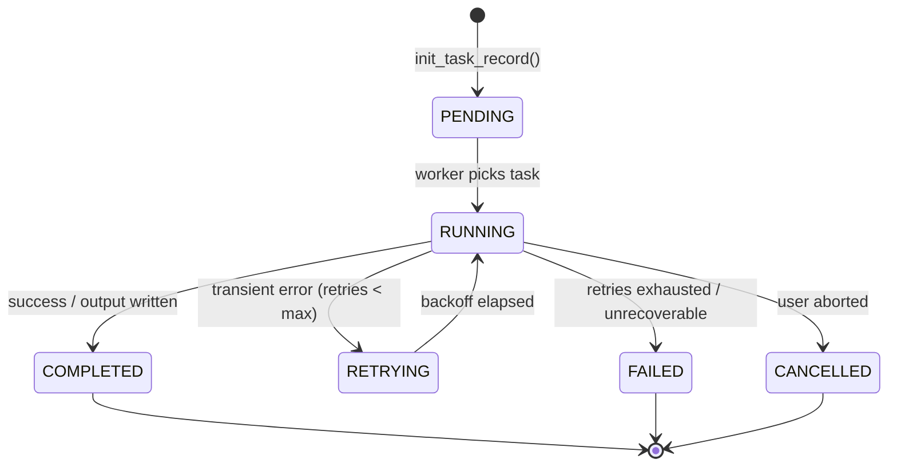

# Celery Asynchronous Task Architecture

## Queue Architecture

PRAMANA isolates asynchronous processing into 7 dedicated queues to prevent resource starvation:

| Queue Name | Routing Key | Purpose | Concurrency Model |
| :--- | :--- | :--- | :--- |
| `document_processing` | `doc.#` | 12-stage pipeline execution, chunked streaming | Prefetch 1, heavy CPU |
| `ai_verification` | `ai.#` | Full application scrutiny, rule engine evaluation | Prefetch 2, medium CPU |
| `forensic_analysis` | `forensics.#` | C2PA verification, ELA, double-compression analysis | Prefetch 1, GPU/CPU |
| `risk_scoring` | `risk.#` | Cross-document risk scoring and anomaly detection | Prefetch 4, I/O bound |
| `certificate_verification` | `cert.#` | X.509 chain building, OCSP, CRL lookup | Prefetch 8, I/O bound |
| `report_generation` | `report.#` | PDF deficiency letter rendering, signed export | Prefetch 2, CPU bound |
| `notifications` | `notify.#` | Officer escalation notices, email/webhook alerts | Prefetch 16, Network bound |

## State Machine & Execution Tracking

All tasks record their lifecycle inside `task_execution_records`:

## Idempotency Guarantees

Every task checks for pre-existing completed runs in `task_execution_records` before executing:
1. When a task is retried or re-submitted with identical arguments, it checks `TaskExecutionRecord.status == "COMPLETED"`.
2. If already completed, it returns the cached result without re-executing pipeline stages, preventing duplicate forensic processing.

