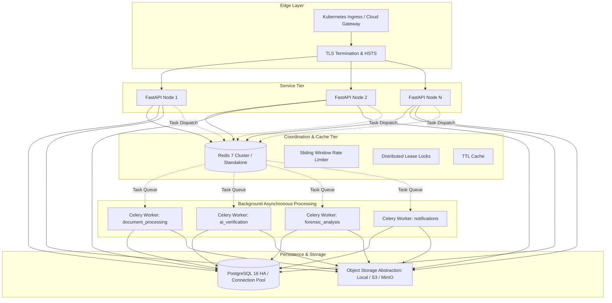

# PRAMANA Distributed System Architecture

## Architecture Overview

PRAMANA's distributed architecture is designed to support nationwide simultaneous institutional submissions, automated regulatory scrutiny, forensic document analysis, and cryptographic provenance verification.

## Core Principles

1. **Stateless API Replicas:** Authentication relies on signed HTTP-only session cookies and CSRF tokens verified against cryptographic signatures. Any API instance can handle any incoming request.
2. **Distributed Locks with Leases:** Application scrutiny operations acquire exclusive locks (`prm:lock:scrutiny:{app_id}`) with automatic TTL expiration to prevent race conditions during concurrent runs.
3. **Queue Segmentation:** Independent worker pools isolate high-frequency, compute-heavy tasks (OCR and forensics) from low-latency critical tasks (status polling and health checks).
4. **Resilient Local Fallbacks:** In standalone test environments, the system automatically falls back to in-memory coordination and eager task execution without crashing or requiring external daemon processes.

