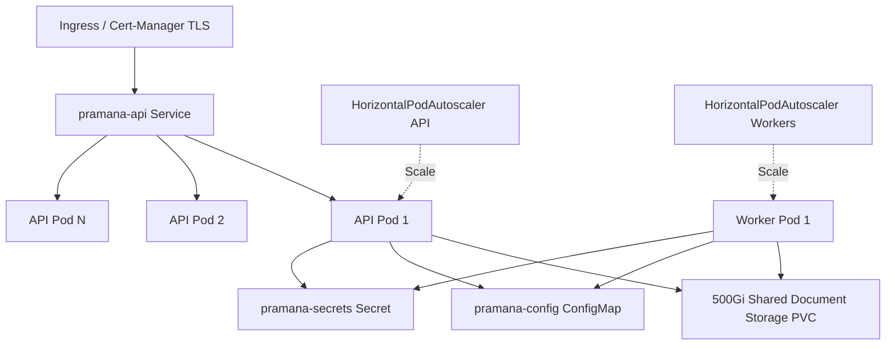

# Kubernetes Enterprise Architecture & Manifests

## Namespace & Workload Architecture

All PRAMANA production resources deploy into the isolated `pramana` namespace (`k8s/namespace.yaml`).

## Manifest Directory Structure (`pramana/k8s/`)

- `namespace.yaml`: Defines `pramana` namespace.
- `configmap.yaml`: System configuration parameters (database host, redis host, CORS origins, log level).
- `secrets.yaml`: Base64 credentials for database and JWT signing secrets.
- `api-deployment.yaml`: Deployment of stateless FastAPI containers with readiness/liveness HTTP probes (`/api/v1/health`, `/api/v1/ready`) and non-root security context.
- `api-service.yaml`: ClusterIP service exposing port 8000.
- `workers-deployment.yaml`: Independent deployments for document processing workers and AI verification workers.
- `hpa-ingress-pvc.yaml`:
  - 500Gi `ReadWriteMany` PersistentVolumeClaim for local document and cryptographic key archives.
  - HPA scaling API pods from 3 to 20 replicas based on 70% CPU / 75% memory targets.
  - Ingress with TLS termination and Let's Encrypt / local cert annotations.

