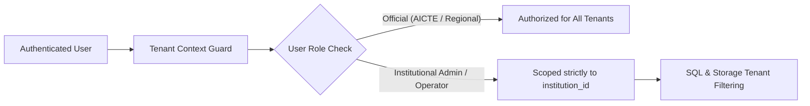

# Multi-Tenant Security & Isolation Architecture

## Multi-Tenant Security Model

PRAMANA implements strict multi-tenancy to ensure that institutions cannot access, inspect, or modify another institution's applications, evidence documents, or audit logs.

## Security Enforcement Layers

1. **API Endpoint Guard:** In `pramana/distributed/gateway.py`, all endpoints checking applications verify `app.institution_id == user.institution_id`. Any attempt to process or inspect foreign applications results in immediate `HTTP 403 Forbidden`.
2. **Object Storage Isolation:** In `pramana/distributed/storage.py`, keys follow tenant-prefixed structures (e.g. `{institution_id}/{uuid}_{filename}`). Institutional users cannot upload or download objects whose keys belong to a foreign institution.
3. **Task Isolation:** Celery tasks carry `institution_id` in their metadata payloads and state records (`task_execution_records`). Task query endpoints verify that institutional callers match the task's originating tenant.

