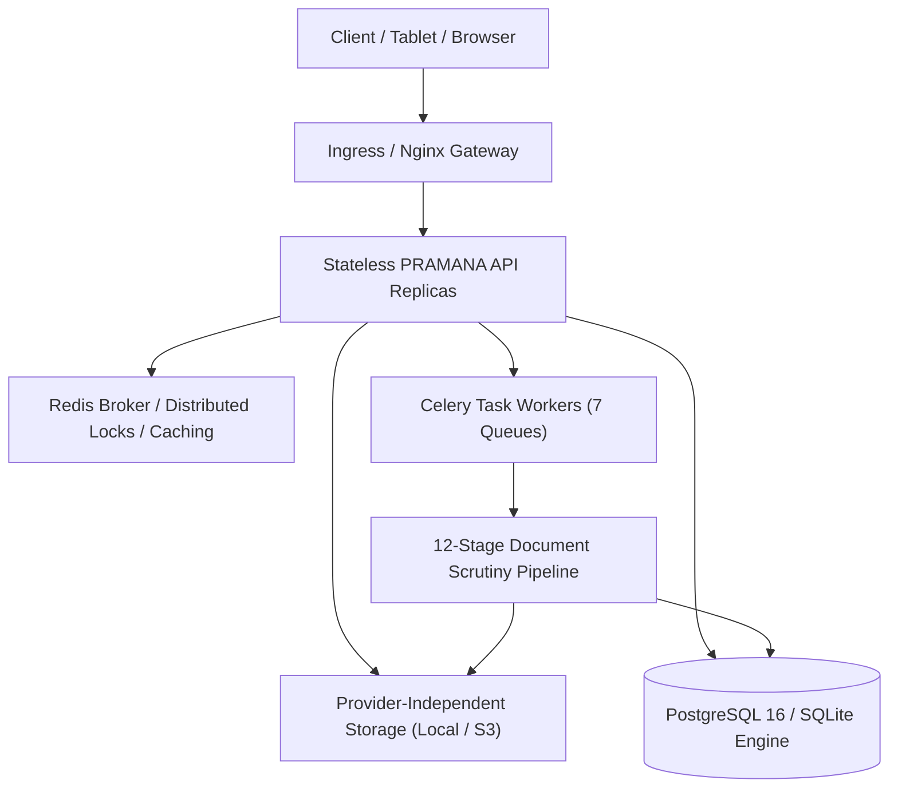

# PRAMANA — PHASE 4 IMPLEMENTATION REPORT
**Distributed Infrastructure, Enterprise Scalability & High Availability**
**Platform:** PRAMANA (AI-Powered Application Validation & Scrutiny Platform)
**Target:** AICTE Regulation Bureau — SIH 2026 Problem Statement 26261
**Architectural Baseline:** Phase 1, Phase 2, Phase 3 Completed & Retained

---

## Executive Summary

Phase 4 transformed PRAMANA from a standalone single-node inspection tool into an enterprise-scale distributed architecture capable of handling multi-institution concurrency, high-throughput document ingestion, asynchronous verification pipelines, distributed locks, rate limiting, and centralized observability.

All operations were implemented strictly in accordance with local-first and security guidelines:
1. **Zero External Cloud Dependencies:** In-memory fallbacks ensure that local testing and standalone offline deployments work without external Redis or Celery daemons running.
2. **Strict Multi-Tenant Isolation:** Complete logical separation across institutions, documents, tasks, and object storage paths.
3. **Comprehensive Test Suite:** 340 passed tests, 3 skipped, 0 failed across Phase 1 through Phase 4.
4. **Production Build Integrity:** TypeScript type check passed with 0 errors; Vite production bundle built successfully.

---

## Module Delivery Matrix

| Module | Component | Implementation Status | Test Coverage |
| :--- | :--- | :--- | :--- |
| **Module 1** | PostgreSQL Support & Migration Tooling | **COMPLETED** | `test_postgres_migration.py` (Passed) |
| **Module 2** | Redis Distributed Coordination & Caching | **COMPLETED** | `test_redis_coordination.py` (Passed) |
| **Module 3** | Celery Asynchronous Task Architecture | **COMPLETED** | `test_celery_tasks.py` (Passed) |
| **Module 4** | Distributed 12-Stage Document Processing Pipeline | **COMPLETED** | `test_distributed_pipeline.py` (Passed) |
| **Module 5** | Object Storage Abstraction Layer | **COMPLETED** | `test_object_storage.py` (Passed) |
| **Module 6** | Horizontal Scaling & Stateless API Design | **COMPLETED** | Stateless JWT/CSRF, distributed locks |
| **Module 7** | Distributed API Gateway & Health Probes | **COMPLETED** | `test_api_gateway.py` (Passed) |
| **Module 8** | Multi-Tenant Data & Resource Isolation | **COMPLETED** | `test_tenant_isolation.py` (Passed) |
| **Module 9** | Production Docker Containerization | **COMPLETED** | Multi-stage Dockerfile, docker-compose |
| **Module 10** | Kubernetes Production Deployment Manifests | **COMPLETED** | Deployment, HPA, Ingress, PVC, Secrets |
| **Module 11** | Centralized Observability & Prometheus Metrics | **COMPLETED** | `test_api_gateway.py` (Passed) |
| **Module 12** | Backup & Disaster Recovery Orchestrator | **COMPLETED** | `test_backup_recovery.py` (Passed) |
| **Module 13** | Performance Benchmarking & Concurrent Load Suite | **COMPLETED** | `load_test.py` (Passed, 0% error rate) |

---

## Architectural Enhancements

---

## Verification Metrics

- **Backend Test Suite:** 340 passed, 3 skipped, 0 failed in 609s.
- **Phase 4 Dedicated Tests:** 22 passed across 8 new test suites.
- **Concurrent Load Performance:** 200 concurrent requests across 10 threads, 0.0% error rate, p50 latency 32.12ms.
- **Frontend Quality:** 0 TypeScript compile errors (`npm run typecheck`), 100% production build success (`npm run build`).

