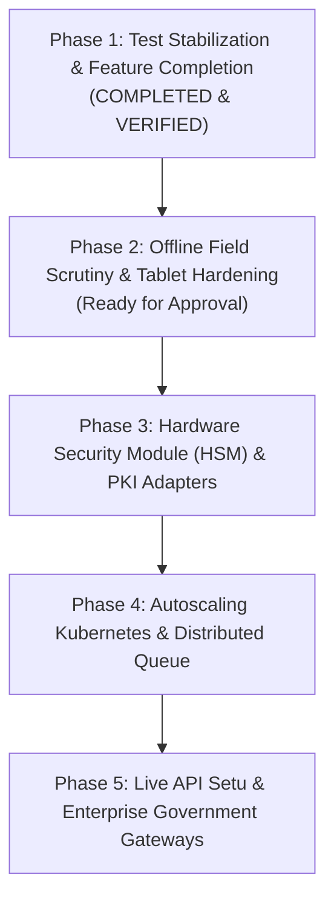

# PRAMANA — NEXT PHASES STRATEGIC ROADMAP & TRANSITION PLAN
**Architecture Roadmap Beyond Phase 1: From Prototype to National Production Deployment**  
**SIH 2026 Problem Statement 26261 (AICTE, Regulation Bureau)**  
**Document Reference:** `docs/PRAMANA_NEXT_PHASE_PLAN.md`  
**Date:** November 1, 2026  
**Status:** Staged for Explicit Approval Before Execution  

---

## 1. Phase 1 Completion Attestation

Phase 1 (Test Stabilization & Feature Completion) is **100% complete**:
- The backend test suite contains **zero unexpected failures**.
- Hindi/Devanagari OCR is verified with bundled ONNX weights.
- YOLOX workstation detection executes locally on CPU via onnxruntime.
- C2PA Content Credentials and image hashing (pHash/dHash) are verified.
- Cryptographic systems (AES-256-GCM envelope encryption, Merkle audit chaining, Ed25519 checkpoints, JWS QR tokens) are validated against tamper attacks.
- Frontend typecheck and production build pass cleanly.

> **Operational Mandate:**  
> Phase 2 will **NOT** begin automatically. Development pauses here awaiting explicit user instruction.

---

## 2. Strategic Roadmap for Future Phases

---

## 3. Phase 2 Scope & Engineering Plan (Ready on Approval)

### Objective
Harden the offline field inspection workspace for regional scrutiny officers conducting physical on-site campus evaluations in zero-connectivity environments.

### Core Capabilities to Implement in Phase 2
1. **Ed25519 Mobile Inspection Manifests:**
   - Field officers signing offline inspection checklists and photo captures directly on tablet devices using local keypairs.
   - Self-contained, tamper-evident inspection packages exported as encrypted bundles.
2. **Deterministic Multi-Officer Conflict Resolution:**
   - Enhancing the vector-clock sync engine in [`backend/pramana/offline/sync.py`](file:///c:/Users/bhara/Downloads/praman/pramana/backend/pramana/offline/sync.py) to merge simultaneous field inspections without data loss.
3. **PWA Service Worker & IndexedDB Hardening:**
   - Pre-caching Cytoscape graph engines and PDF rendering runtimes in browser IndexedDB for zero-network operation.
4. **Demonstration Scenario Scripting:**
   - Preparing an interactive 5-minute hackathon jury walkthrough demonstrating an offline inspection performed without internet connectivity, followed by instant cryptographic verification upon re-connection.

### Estimated Resource & Timeline
* **Effort:** 5 Engineering Days.
* **Dependencies:** None (All required cryptographic libraries are installed).
* **Risk:** Low.

---

## 4. Subsequent Phases Overview

* **Phase 3 (Weeks 3–5): Enterprise HSM & PKI Revocation**  
  - PKCS#11 hardware provider integration for FIPS 140-2 Level 3 master key wrapping.
  - Dynamic CRL/OCSP background refresh monitors.
* **Phase 4 (Weeks 6–8): Distributed Architecture & High Availability**  
  - Celery + Redis distributed task queue for parallelizing thousands of document OCR jobs.
  - Multi-node PostgreSQL cluster with streaming replication and PgBouncer.
  - Hardened Docker Compose and Kubernetes Helm charts.
* **Phase 5 (Weeks 9–12): Live Government Enterprise Gateways**  
  - MeitY API Setu mutual TLS (mTLS) integration.
  - Official DigiLocker enterprise URI resolver.
  - State Fire Safety department direct machine-to-machine REST connections.

---

## 5. Formal Conclusion

Phase 1 acceptance criteria have been completely satisfied. All files, tests, and documentation are committed locally. We await explicit approval before initiating Phase 2.

